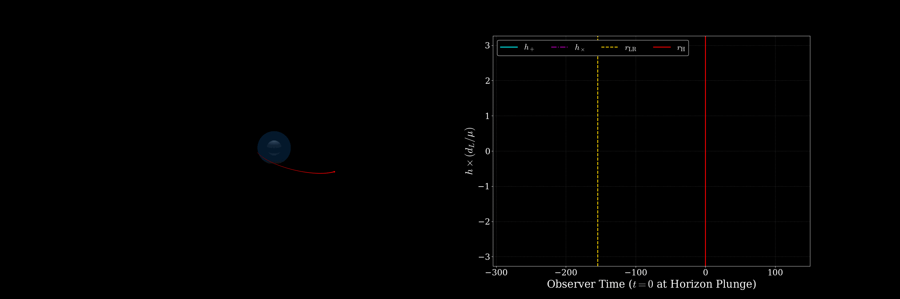

  
*FIG 1. g-factor (energy-shift) contour showing the black-hole (BH) shadow. The observer is at* \\((r_o,\theta_o)=(2000M, 80^{\circ})\\) *and the BH spin is* \\(a=0.9\\). *This figure is generated using [PyHole](https://gitlab.com/EuropeanSpaceAgency/PyHole) via the ray-tracing of null geodesics onto a disk and calculating the change in the 4-momentum due to the rotation of the disk.*

I like solving puzzles, so physics is the natural place to harness my creative energy. I enjoy learning new mathematical techniques and applying them to real-life systems. Currently, my main research area is black-hole (BH) physics, but from time to time, I do enjoy learning about other interesting areas of physics like fluid dynamics, electrodynamics, complex systems, etc. The most exciting part is when I get to integrate ideas that I learn from other disciplines with my research on BHs. Below, I provide an overview of my current projects, and some thoughts that keep me up at night...

<!-- Research card grid: 3 columns x 2 rows with hover overlays. -->

  <a class="research-link" href="/research/emris-in-astrophysical-environments/">
    

      
      
EMRIs in Astrophysical Environments

    

  </a>

  <a class="research-link" href="/research/bh-spectroscopy-in-astrophysical-environments/">
    

      
      
BH Spectroscopy in Astrophysical Environments

    

  </a>

  <a class="research-link" href="/research/grhd-grmhd-simulations/">
    

      
      
GRHD / GRMHD Simulations

    

  </a>

  <a class="research-link" href="/research/modeling-xray-signatures-near-smbhs/">
    

      
      
Modeling X-ray Signatures near SMBHs

    

  </a>

  <a class="research-link" href="/research/modeling-em-signals-from-gw-sources/">
    

      
      
Modeling EM Signals from GW Sources

    

  </a>

  <a class="research-link" href="/research/problems-in-cosmology/">
    

      
      
Problems in Cosmology

    

  </a>

## Extreme-Mass-Ratio Inspirals (EMRIs)
------

*FIG. 2: EMRI with mass ratio* \\(q=5\\times 10^{-6}\\) *, where red and blue trails are the trajectories for spinning and non-spinning secondary in Kerr spacetime, respectively. The orbital parameters are* \\((a, p, e, x)=(0.95M,8M, 0.65, \\cos(\\pi/4))\\). *The trajectory of the spinning secondary is governed by the Matthison-Papapetrou-Dixon (MPD) equations, and has dimensionless spin* \\(\\chi=0.95\\). *The geodesics for blue trail is computed using [kerrgeopy](https://github.com/BlackHolePerturbationToolkit/KerrGeoPy) and are evolved using [pybhpt](https://github.com/znasipak/pybhpt). The red trail is computed using my own adapted version of [kerrgeopy](https://github.com/BlackHolePerturbationToolkit/KerrGeoPy) using the analytical MPD solution from [Skoupý & Witzany](https://journals.aps.org/prl/abstract/10.1103/PhysRevLett.134.171401) and is evolved using [pybhpt](https://github.com/znasipak/pybhpt) and [KerrSpinningFluxes](https://github.com/vskoupy/KerrSpinningFluxes).* 

Extreme-mass-ratio inspirals (EMRIs) are binary systems with mass ratio \\(q\\lesssim 10^{-5}\\), consisting of a stellar/intermediate-mass secondary (i.e. black holes (BHs), neutron stars (NSs), white dwarfs (WDs), etc.) orbiting a massive black hole (MBH) of mass \\(M\\gtrsim 10^{5}M_{\\odot}\\). These systems are the primary targets for space-based millihertz gravitational-wave (GW) detectors such as LISA, TianQin (天琴), and Taiji (太极).

## Gravitational Waves (GWs) from EMRIs
------
EMRIs are one of the primary targets for space-based millihertz gravitational-wave (GW) detectors such as the Laser Interferometer Space Antenna (LISA), TianQin (天琴), and Taiji (太极). As seen in the figure above, the signal from an EMRI encodes the detailed geometry of the spacetime and the dynamics of the compact object as it spirals in.

*FIG. 3: EMRI on stable orbit and its GW signal. The orbital parameters are* \\((a, p, e, x)=(0.95M,8M, 0.65, \\cos(\\pi/4))\\). *The trajectory and waveform are evolved using [kerrgeopy](https://github.com/BlackHolePerturbationToolkit/KerrGeoPy) and [pybhpt](https://github.com/znasipak/pybhpt).* 

As seen in FIG. 3, for EMRIs on eccentric orbits, the GW signal peaks when the secondary is at periapsis, and the converse occurs at apoapsis. This creates a distinctive "beating" pattern, and gives a unique opportunity to infer the binary parameters.

*FIG. 4: EMRI trajectory plunge with mass ratio* \\(q=4\\times 10^{-7}\\) *and its GW signal. The plunge time is set to* \\(t=0\\), *and the initial constants of motion are* \\((a, \\mathscr{E}, \\mathcal{L}_z, \\mathcal{Q})\\). *The trajectory and waveform are evolved using [kerrgeopy](https://github.com/BlackHolePerturbationToolkit/KerrGeoPy) and [pybhpt](https://github.com/znasipak/pybhpt).* 

As the secondary rapidly sheds its remaining orbital constants across the Last Stable Orbit (LSO), it breaks from its adiabatic inspiral and accelerates into a dynamic, freefall trajectory. During this stage, the spacetime curvature is extreme, and the final portion of the waveform encodes the last moments before the compact object crosses the event horizon.

The extreme spacetime curvature at the light ring causes the emission of high-frequency GWs during the plunge to become temporarily "trapped" within the potential cavity of the photon sphere. Instabilities and nonlinear couplings then drive the system toward a final burst of GW strain.

Ultimately, the secondary violently crosses the event horizon, culminating the plunge with a peak burst of GW strain. The newly merged system—now a highly perturbed, asymmetric MBH—must rapidly relax to a more stable state through ringdown dynamics.

## Environmental Effects (EEs) on EMRI GWs
As mentioned previously, the long orbital timescales allow for small perturbations to manifest as considerable changes in the orbital evolution. These changes modify the GW signals, which can be probed with future detectors and used to infer the astrophysical environment around the MBH.

## Probing Strong Gravity with EMRIs

## Other Thoughts and Ideas
