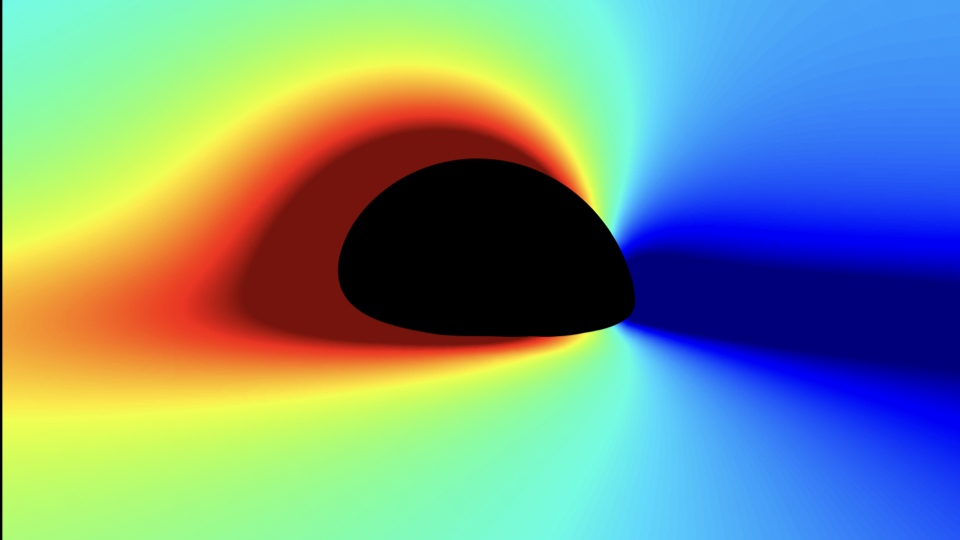

  
*FIG 1. g-factor (energy-shift) contour showing the black-hole (BH) shadow. The observer is at* \\((r_o,\theta_o)=(2000M, 80^{\circ})\\) *and the BH spin is* \\(a=0.9\\). *This figure is generated using [PyHole](https://gitlab.com/EuropeanSpaceAgency/PyHole) via the ray-tracing of null geodesics onto a disk and calculating the change in the 4-momentum due to the rotation of the disk.*

I like solving puzzles, so physics is the natural place to harness my creative energy. I enjoy learning new mathematical techniques and applying them to real-life systems. Currently, my main research area is black-hole (BH) physics, but from time to time, I do enjoy learning about other interesting areas of physics like fluid dynamics, electrodynamics, complex systems, etc. The most exciting part is when I get to integrate ideas that I learn from other disciplines with my research on BHs. Below, I provide an overview of my current projects, and some thoughts that keep me up at night...

<!-- Research card grid: 3 columns x 2 rows with hover overlays. -->

  <a class="research-link" href="/research/emris-in-astrophysical-environments/">
    

      
      
EMRIs in Astrophysical Environments

    

  </a>

  <a class="research-link" href="/research/bh-spectroscopy-in-astrophysical-environments/">
    

      
      
BH Spectroscopy in Astrophysical Environments

    

  </a>

  <a class="research-link" href="/research/grhd-grmhd-simulations/">
    

      
      
GRHD / GRMHD Simulations

    

  </a>

  <a class="research-link" href="/research/modeling-xray-signatures-near-smbhs/">
    

      
      
Modeling X-ray Signatures near SMBHs

    

  </a>

  <a class="research-link" href="/research/modeling-em-signals-from-gw-sources/">
    

      
      
Modeling EM Signals from GW Sources

    

  </a>

  <a class="research-link" href="/research/problems-in-cosmology/">
    

      
      
Problems in Cosmology

    

  </a>

